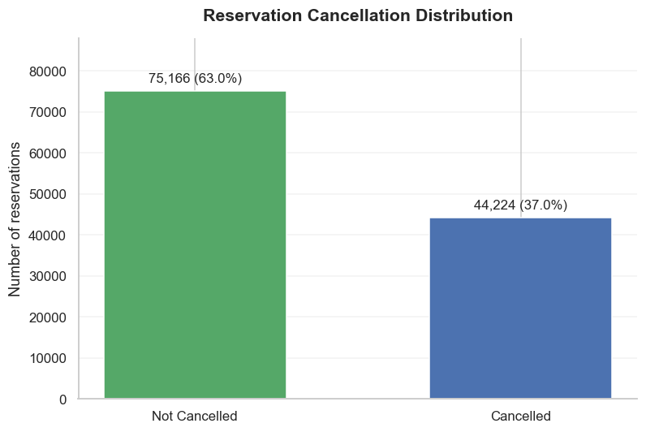
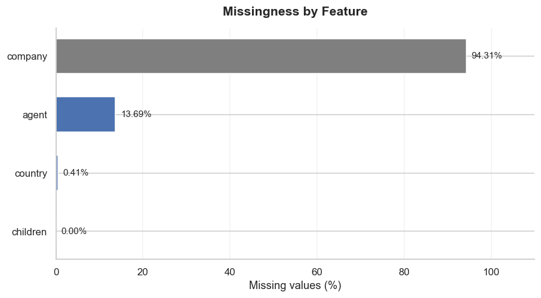
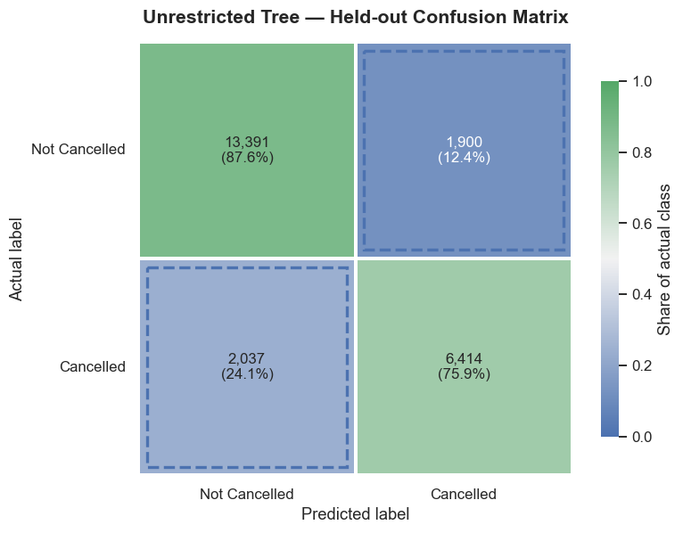
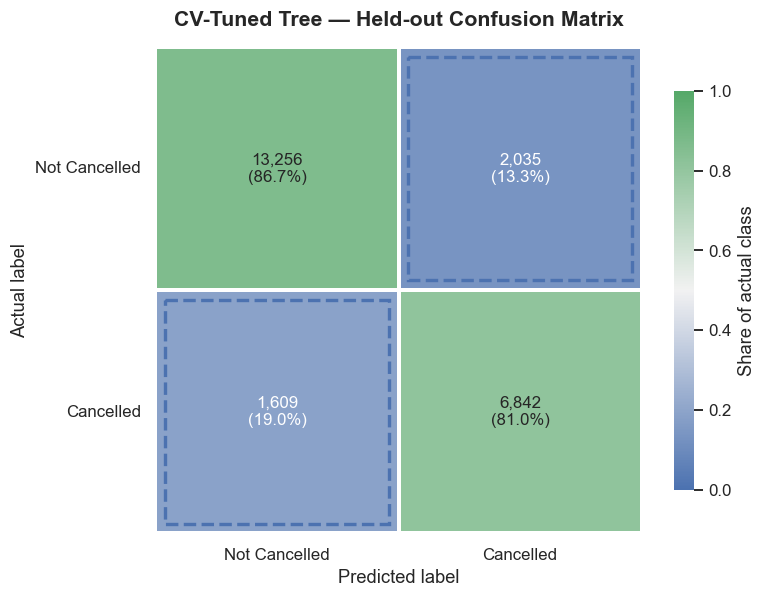
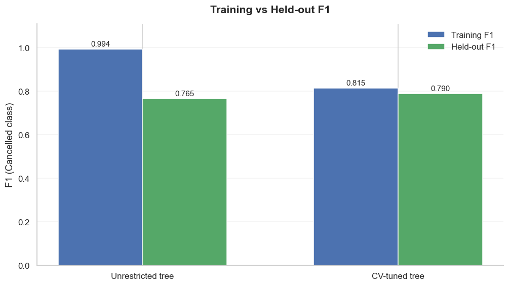
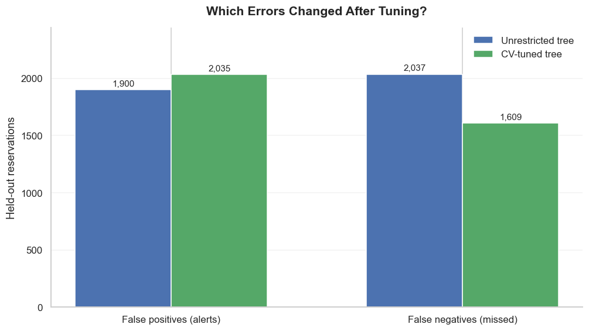
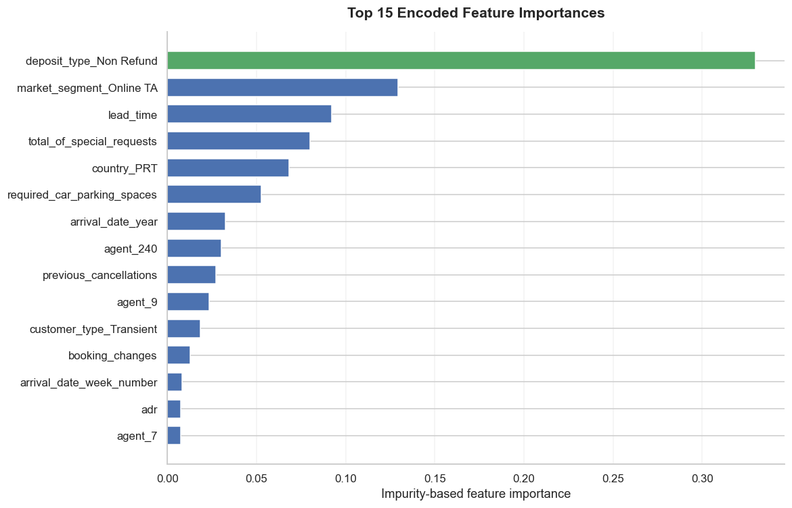
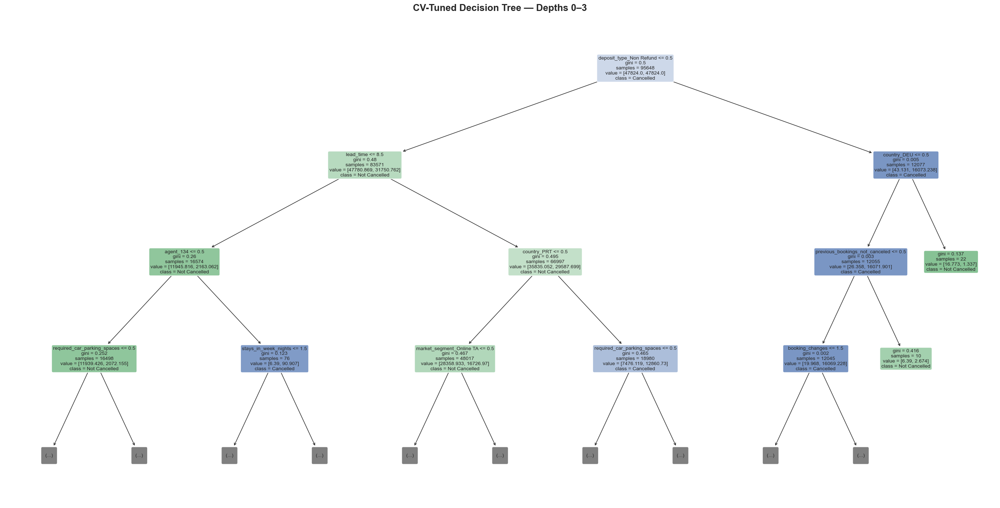
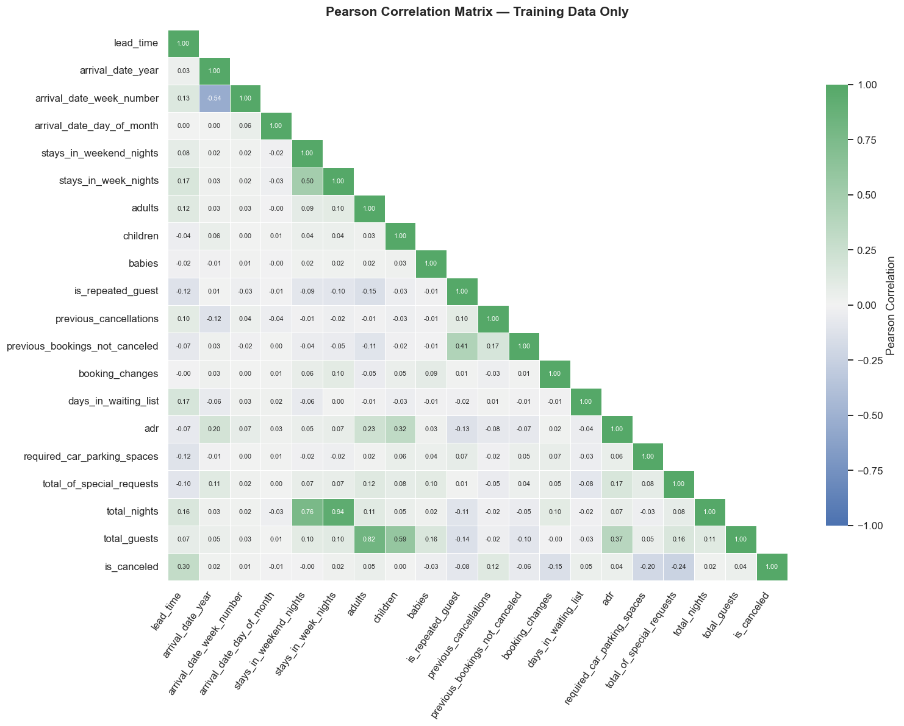

# Hotel Booking Cancellation Prediction | Decision Tree

Can booking details help identify reservations at risk of cancellation? In this project I explore that question with an interpretable Decision Tree, paying as much attention to **evaluation design and model errors** as to the final F1 score.

I examine the data, remove outcome leakage, build a preprocessing pipeline, and compare an unrestricted tree with a tuned one. Because the dataset contains many repeated rows, I keep identical **predictor patterns** together in both the held-out split and cross-validation.

> **Scope:** This is a pre-arrival research experiment, not a deployed booking-creation model. Some retained booking fields may change over time, and the results have not been tested on a future period or a separate hotel.

## At a glance

| | Result |
|---|---|
| Dataset | 119,390 bookings × 32 original columns |
| Target | `is_canceled` (`0` = Not Cancelled, `1` = Cancelled) |
| Exact duplicate raw rows | 31,994 |
| Repeated retained-predictor rows | 33,534 |
| Train / held-out test | 95,648 / 23,742 rows |
| Cancellation rate (train / test) | 37.4% / 35.6% |
| Shared predictor groups across train/test | **0** |
| Model search | 32 configurations × 5 grouped folds = 160 fits |
| Best grouped-CV F1 (fold SD) | 0.7948 (0.0054) |

## Results on the held-out groups

| Metric | Unrestricted tree | CV-tuned tree |
|---|---:|---:|
| Accuracy | 0.8342 | 0.8465 |
| Precision — Cancelled | 0.7715 | 0.7708 |
| Recall — Cancelled | 0.7590 | 0.8096 |
| F1 — Cancelled | 0.7652 | **0.7897** |
| Training F1 | 0.9936 | 0.8152 |
| Train–test F1 gap | 0.2284 | 0.0254 |
| Tree depth | 49 | 12 |
| Leaves | 9,823 | 373 |
| False positives (false alerts) | 1,900 | 2,035 |
| False negatives (missed cancellations) | 2,037 | 1,609 |

The tuned tree's held-out F1 improved by **+0.0245**. Recall increased while precision remained nearly unchanged. The model identified **428 more actual cancellations**, at the cost of **135 additional false alerts**. The selected configuration uses `class_weight="balanced"`; this may contribute to the recall-oriented trade-off, but the observed change cannot be attributed to that setting alone because other parameters also changed.

A paired bootstrap resampling complete held-out predictor groups produced a **95% interval of [+0.0141, +0.0346]** for the F1 difference (2,000 resamples). This describes uncertainty conditional on the held-out sample and fitted models, not future-period performance.

The majority-class reference model achieved **0.6440 accuracy** but **0.0000 F1** for cancellations, showing why accuracy alone is insufficient.

### Selected tree settings

| Hyperparameter | Selected value |
|---|---|
| Criterion | `gini` |
| Max depth | `12` |
| Minimum samples per split | `10` |
| Minimum samples per leaf | `10` |
| Class weight | `balanced` |
| Cost-complexity alpha | `0.0` (fixed, not tuned) |

This is a deliberately small grid: each varied parameter has only two candidate values. The top five mean CV F1 scores span about **0.0007**, so their ranking should not be overinterpreted relative to fold-to-fold variation.

## Visual analysis

| Class distribution | Missing values |
|---|---|
|  |  |

**Unrestricted tree — held-out confusion matrix**



**CV-tuned tree — same row-normalized scale**



| Training vs held-out F1 | Error trade-off |
|---|---|
|  |  |

| Top feature importances | First levels of the tuned tree |
|---|---|
|  |  |

**Training-only Pearson correlation heatmap**



The palette uses blue `#4C72B0`, green `#55A868`, and neutral gray `#7F7F7F`. Confusion matrices use a fixed 0–100% row scale and display raw counts alongside percentages.

## Method

1. **Check the data.** Inspect missing values, cancellation balance, data types, and repeated rows.
2. **Review feature availability.** Remove `reservation_status` and `reservation_status_date` (final-outcome leakage), `assigned_room_type` (timing uncertainty), and `company` (high missingness and identifier semantics).
3. **Engineer two features.** `total_nights` summarizes stay length; `total_guests` summarizes party size. Treat `agent` as a category, not a numeric amount.
4. **Hold out repeated patterns.** Hash retained predictor columns, excluding the target, and hold out one `StratifiedGroupKFold` fold. Verify there are no shared groups.
5. **Fit preprocessing inside the pipeline.** Median imputation for numeric features; most-frequent imputation and one-hot encoding for categorical features.
6. **Tune on training folds only.** Five-fold `StratifiedGroupKFold` in `GridSearchCV`, selecting by cancellation F1. The test set stays out of hyperparameter selection.
7. **Interpret the final test.** Compare F1, precision, recall, error types, tree size, and impurity-based feature importance. Estimate within-split uncertainty using a paired group bootstrap.

## Run locally or on Kaggle

**Data:** Download the original [Hotel Booking Demand dataset](https://www.kaggle.com/datasets/jessemostipak/hotel-booking-demand) and place `hotel_bookings.csv` in `data/`. The raw CSV is intentionally excluded from this repository.

```bash
python -m pip install -r requirements.txt
jupyter notebook
```

Open `notebooks/Hotel_Booking_Cancellation_Prediction_Decision_Tree.ipynb` and select **Restart & Run All**. The 160-fit grid search can take several minutes. Running from the repository root or the `notebooks/` folder is supported.

**On Kaggle:** Upload the `.ipynb` file, attach the Hotel Booking Demand dataset using **Add Input**, and run the notebook. The data loader checks `/kaggle/input` automatically. The nine plots are saved as PNGs to `images/` under the working directory.

**Output behavior:** The notebook saves nine figures to `images/` and clears old PNGs from that folder at startup. [`docs/run_metrics.json`](docs/run_metrics.json) is a static snapshot of the saved run; the notebook does not update it. If you rerun the notebook and publish new results, refresh the README, figures, and snapshot together. More detail is in the [validation notes](docs/Validation_Report.md).

Keep any unrelated PNGs (for example, logos) outside `images/`, such as in `assets/`, because the startup cleanup deletes all PNGs in `images/`.

## Limitations

- Exact predictor matches do not prove that rows represent the same guest or reservation. Grouping controls one kind of overlap, not all dependencies.
- The data covers 2015–2017; no chronological hold-out or separate-hotel evaluation was performed. `arrival_date_year` and calendar or price fields may capture period-specific patterns.
- The intended pre-arrival prediction time needs a source-system audit. Some retained features, including booking changes, price, and special requests, can evolve during the reservation lifecycle.
- High-cardinality agent and country categories can learn dataset-specific patterns.
- The importance of `deposit_type_Non Refund` may reflect reservation policies or recording practices. Impurity-based importance does not establish cause and effect.
- F1 is an educational selection metric; an operational system would need a cost-sensitive threshold and monitoring.

## Attribution and license

The [Hotel Booking Demand dataset](https://www.kaggle.com/datasets/jessemostipak/hotel-booking-demand) is distributed by Jesse Mostipak under **CC BY 4.0** and draws on *Hotel Booking Demand Datasets* by Nuno António, Ana de Almeida, and Luís Nunes ([Data in Brief, 2019](https://doi.org/10.1016/j.dib.2018.11.126)). This repository does not redistribute the dataset. The MIT license covers the original project code and documentation.

## Author

Anahita Pouladi · [GitHub](https://github.com/anahitapouladi) · [Kaggle](https://www.kaggle.com/anahitapouladi)
