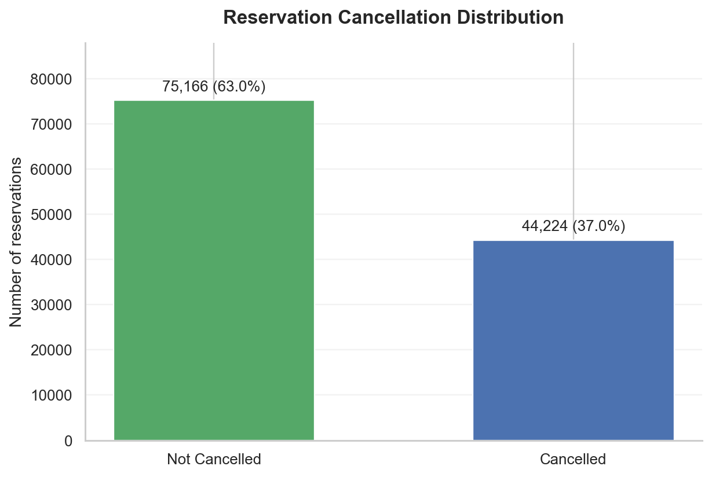
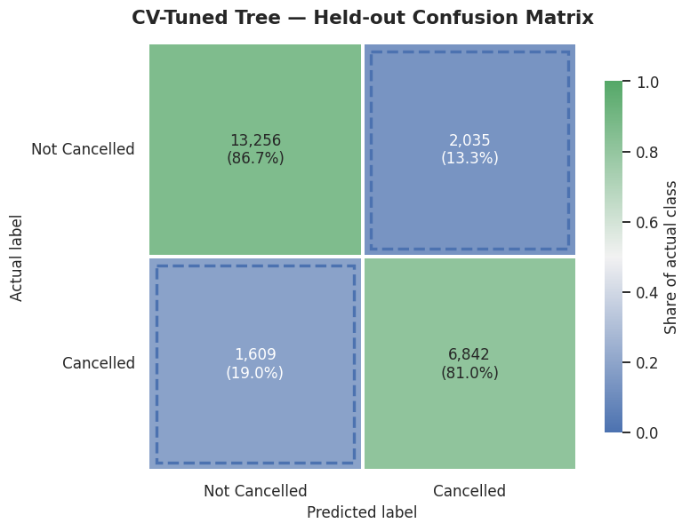
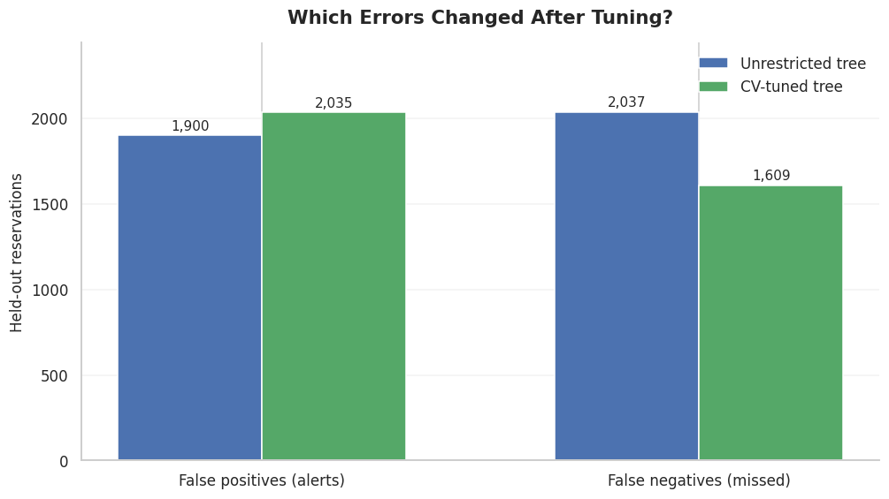
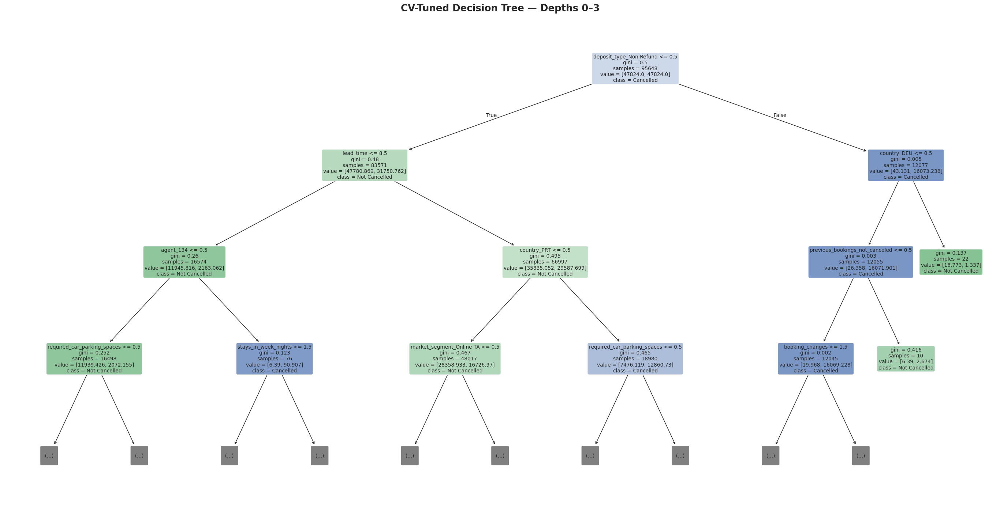
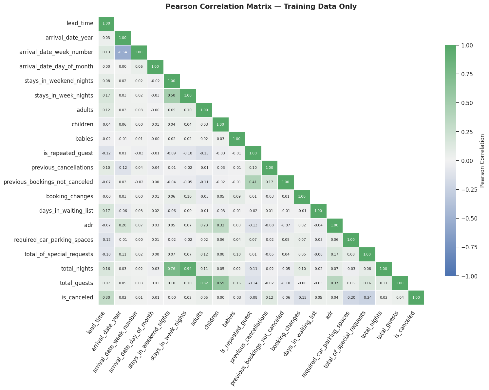

# Hotel Booking Cancellation Prediction | Decision Tree

Can booking details help identify reservations at risk of cancellation before arrival? In this project, I use an interpretable Decision Tree to explore that question. I focus not only on the final F1 score, but also on repeated records, feature availability, overfitting, and the kinds of mistakes the model makes.

The notebook compares an unrestricted Decision Tree with a version selected through group-aware cross-validation. Because the dataset contains many repeated booking patterns, identical **predictor patterns** are kept together during both the train/test split and cross-validation.

> **Scope:** This is a pre-arrival research experiment, not a deployed booking-creation prediction system. Some retained booking details can change during the reservation lifecycle. The results have not been tested on a later time period or at a different hotel.

## Project links

- **GitHub project:** [hotel-booking-cancellation-decision-tree](https://github.com/anahitapouladi/hotel-booking-cancellation-decision-tree)
- **Kaggle notebook:** [Hotel Booking Cancellation Prediction — Decision Tree](https://www.kaggle.com/code/anahitapouladi/hotel-booking-cancellation-decision-tree)
- **Source dataset:** [Hotel Booking Demand](https://www.kaggle.com/datasets/jessemostipak/hotel-booking-demand)

## At a glance

| | Result |
|---|---:|
| Dataset | 119,390 bookings × 32 original columns |
| Target | `is_canceled` (`0` = Not Cancelled, `1` = Cancelled) |
| Exact duplicate raw rows | 31,994 (26.8%) |
| Distinct retained-predictor patterns | 85,856 |
| Repeated retained-predictor rows | 33,534 (28.1%) |
| Conflicting-label predictor patterns | 282 patterns across 2,084 rows |
| Train / held-out test | 95,648 / 23,742 rows |
| Cancellation rate (train / test) | 37.4% / 35.6% |
| Shared predictor groups across train/test | **0** |
| Model search | 32 configurations × 5 grouped folds = 160 fits |
| Best grouped-CV F1 (fold SD) | 0.7948 (0.0054) |

The repeated-predictor count is larger than the exact-duplicate count because different raw rows can become identical after columns are removed, and because some identical predictor patterns have different cancellation labels. The notebook keeps all rows; grouping changes how the data is split, not how often each row contributes to the metrics.

## Results on the held-out groups

All results below come from the saved Kaggle run in the notebook. The same held-out test fold is used for both trees.

| Metric | Unrestricted tree | CV-tuned tree |
|---|---:|---:|
| Accuracy | 0.8342 | 0.8465 |
| Precision — Cancelled | 0.7715 | 0.7708 |
| Recall — Cancelled | 0.7590 | 0.8096 |
| F1 — Cancelled | 0.7652 | **0.7897** |
| Training F1 | 0.9936 | 0.8152 |
| Train–test F1 gap | 0.2284 | 0.0254 |
| Tree depth | 49 | 12 |
| Leaves | 9,823 | 373 |
| False positives (false alerts) | 1,900 | 2,035 |
| False negatives (missed cancellations) | 2,037 | 1,609 |

The tuned tree's held-out F1 increased by **0.0245**. Recall rose from 0.7590 to 0.8096, while precision changed slightly from 0.7715 to 0.7708. In practical terms, the tuned model missed **428 fewer cancellations**, while producing **135 additional false alerts**. Whether that is a worthwhile trade-off depends on the cost of each type of error for a hotel.

A paired bootstrap that resamples complete predictor groups produced a **95% interval of [+0.0141, +0.0346]** for the F1 difference (2,000 resamples). This interval describes variation within this one held-out sample and fitted-model comparison. It does not measure uncertainty from retraining, future periods, or transfer to another hotel.

The majority-class reference achieved **0.6440 accuracy** but **0.0000 F1** for cancellations. This is a useful reminder that accuracy alone can hide a model's inability to identify the minority class.

### Selected tree settings

| Hyperparameter | Selected value |
|---|---|
| Criterion | `gini` |
| Maximum depth | `12` |
| Minimum samples per split | `10` |
| Minimum samples per leaf | `10` |
| Class weight | `balanced` |
| Cost-complexity alpha | `0.0` (fixed, not tuned) |

The search is intentionally compact: each varied parameter has two candidate values. The best mean grouped-CV F1 was **0.7948** (fold SD **0.0054**). The top-five mean CV scores span only **0.0007**, so their small ranking differences should not be overinterpreted.

## Visual analysis

### Data quality and class balance

| Cancellation distribution | Missing values |
|---|---|
|  |  |

There are 44,224 cancellations among 119,390 bookings (37.0%). `company` is missing in 94.31% of rows, `agent` in 13.69%, `country` in 0.41% (488 rows), and `children` in four rows. I drop `company`, treat missing `agent` values as an `Unknown` category, and handle the remaining missing values inside the preprocessing pipeline.

### Held-out errors

**Unrestricted tree**


**Cross-validation-tuned tree**



The unrestricted tree misses 2,037 cancellations and raises 1,900 false alerts. The tuned tree misses 1,609 cancellations and raises 2,035 false alerts. Both confusion matrices use the same class order and row-normalized color scale.

### Overfitting and error trade-off

| Training vs. held-out F1 | Error trade-off |
|---|---|
|  |  |

The unrestricted tree nearly memorizes the training data (F1 0.9936) but scores 0.7652 on held-out groups. The tuned tree has a much smaller train–test gap and a simpler structure, while shifting the error balance toward more detected cancellations and more false alerts.

### What the tree learned

| Feature importance | First levels of the tuned tree |
|---|---|
|  |  |

`deposit_type_Non Refund` is the first split and the most important encoded feature (0.3298). The next four features are `market_segment_Online TA` (0.1295), `lead_time` (0.0922), `total_of_special_requests` (0.0799), and `country_PRT` (0.0684). These are patterns used by this fitted tree, not causal explanations for why a guest cancels. The tree diagram shows only the first four levels for readability; predictions use the full fitted tree. Because `class_weight="balanced"` is selected, the `value` fields in the diagram are weighted class totals, not raw booking counts.

### Training-only correlation heatmap



The strongest linear association with cancellation is `lead_time` (+0.30). `total_of_special_requests` (−0.24), `required_car_parking_spaces` (−0.20), and `booking_changes` (−0.15) are negatively associated in this training partition. Correlation captures linear association only; a Decision Tree can also use nonlinear patterns and interactions.

## Method

1. **Inspect the raw data.** Check schema, missingness, cancellation balance, and exact duplicate rows.
2. **Review feature availability.** Remove `reservation_status` and `reservation_status_date` because they reveal the final outcome; also remove `assigned_room_type` because its timing may change, and `company` because it is highly missing and identifier-like.
3. **Prepare features.** Treat `agent` as a category rather than a numeric amount, use `Unknown` for missing agent IDs, and create `total_nights` and `total_guests`.
4. **Keep repeated predictor patterns together.** Hash predictor columns only (excluding the target), then use the first held-out fold from `StratifiedGroupKFold(n_splits=5, shuffle=True, random_state=42)`. The notebook verifies that no predictor group appears in both partitions.
5. **Fit preprocessing inside a pipeline.** Numeric values are median-imputed. Categorical values are imputed with the most frequent training category and one-hot encoded. Unknown categories are ignored at prediction time.
6. **Tune on training folds only.** Use five-fold `StratifiedGroupKFold` in `GridSearchCV`, selecting by F1 for the cancelled class. The held-out test set is not used for hyperparameter selection.
7. **Evaluate and inspect.** Compare classification metrics, confusion matrices, tree complexity, feature importance, and a paired predictor-group bootstrap interval.

## Repository layout

```text
hotel-booking-cancellation-decision-tree/
├── README.md
├── requirements.txt
├── LICENSE
├── .gitignore
├── notebooks/
│   └── Hotel_Booking_Cancellation_Prediction_Decision_Tree.ipynb
├── images/                         # nine figures from the saved Kaggle run
├── docs/
│   ├── PROJECT_DOCUMENTATION.md
│   └── run_metrics.json
└── data/
    └── README.md                   # instructions; CSV is not committed
```

## Run locally or on Kaggle

**Data:** Download the original [Hotel Booking Demand dataset](https://www.kaggle.com/datasets/jessemostipak/hotel-booking-demand) and place `hotel_bookings.csv` in `data/` (see [`data/README.md`](data/README.md)). The raw CSV is intentionally not committed to this repository.

```bash
python -m pip install -r requirements.txt
jupyter lab
```

Open the notebook and choose **Restart & Run All**. The data loader checks the repository data paths and Kaggle input folders. The notebook saves nine figures to `images/`.

**Saved Kaggle runtime:** The notebook metadata records Python **3.10.9**. The Kaggle runtime versions reported for this saved run are pandas **1.5.3**, NumPy **1.23.5**, and scikit-learn **1.2.1**. The exact Matplotlib, Seaborn, IPython, and Jupyter versions were not recorded, so those packages are listed without version pins in `requirements.txt`.

**Metrics snapshot:** [`docs/run_metrics.json`](docs/run_metrics.json) is a static snapshot of the saved notebook run; rerunning the notebook does not update it automatically. If you publish a new run, refresh the notebook outputs, Markdown explanations, nine figures, README, documentation, and metrics snapshot together.

For the detailed validation notes and interpretation, see [`docs/PROJECT_DOCUMENTATION.md`](docs/PROJECT_DOCUMENTATION.md).

## Limitations

- Identical predictor values do not prove that rows represent the same guest or reservation. Grouping prevents exact predictor patterns from crossing the split, but it does not remove all possible dependencies.
- There are 282 retained-predictor patterns (2,084 rows) with conflicting cancellation labels, so the available predictors do not perfectly determine the outcome.
- The dataset covers 2015–2017. No chronological hold-out or separate-hotel evaluation was performed. Calendar and price-related features may capture period-specific patterns.
- The intended prediction point needs a source-system audit. Some retained fields—including `booking_changes`, `adr`, special requests, and parking spaces—may change during the booking lifecycle.
- High-cardinality `agent` and `country` categories may capture dataset-specific patterns.
- The importance of `deposit_type_Non Refund` may reflect booking policies or recording practices. Impurity-based importance is not causal evidence.
- Missing `country` values (488 rows) are imputed with the most frequent category (`PRT`). A separate `Unknown` category would be more transparent.
- The split, selected settings, and error trade-off may change with the dataset, random seed, or library version. The reported F1 gain is specific to this saved run.
- F1 is an educational model-selection metric. An operational system would need a decision threshold based on the real costs of missed cancellations and false alerts, plus monitoring.

## Attribution and license

The [Hotel Booking Demand dataset](https://www.kaggle.com/datasets/jessemostipak/hotel-booking-demand) is distributed by Jesse Mostipak under **CC BY 4.0** and draws on *Hotel Booking Demand Datasets* by Nuno António, Ana de Almeida, and Luís Nunes ([Data in Brief, 2019](https://doi.org/10.1016/j.dib.2018.11.126)). This repository does not redistribute the dataset. The [MIT license](LICENSE) covers the original project code and documentation.

## Author

Anahita Pouladi · [GitHub](https://github.com/anahitapouladi) · [Kaggle](https://www.kaggle.com/anahitapouladi)
