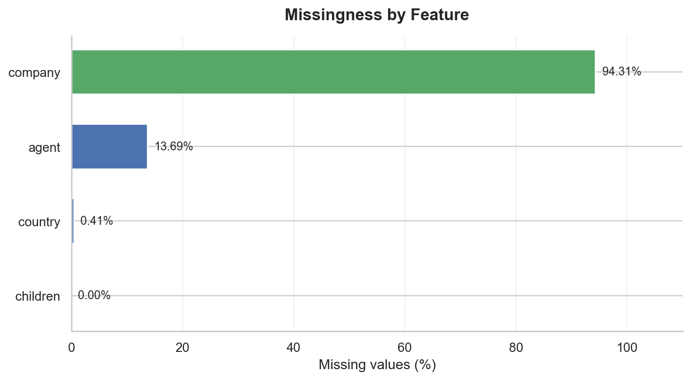
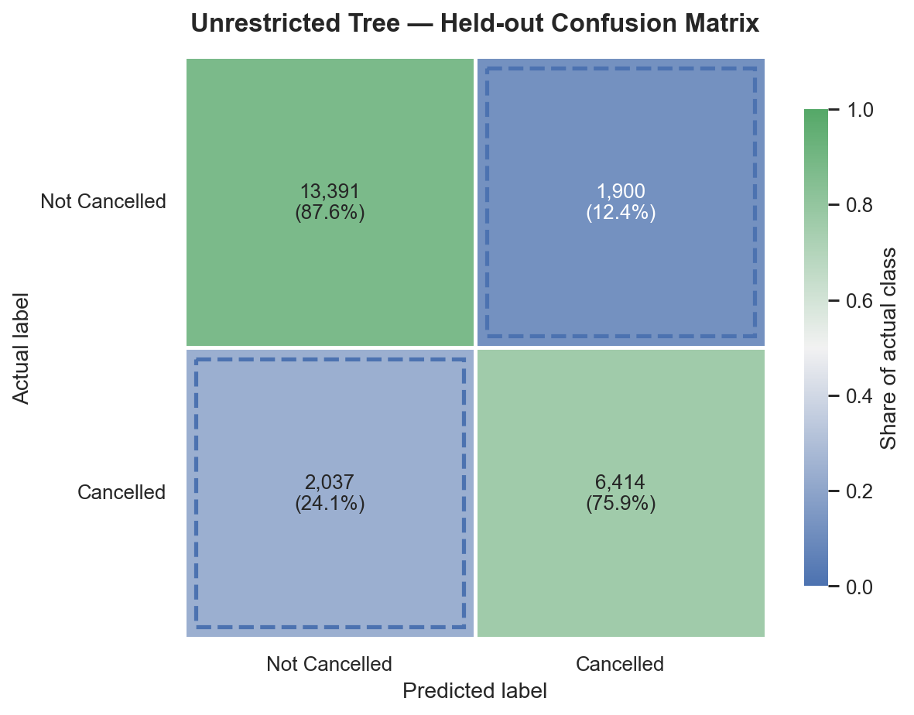
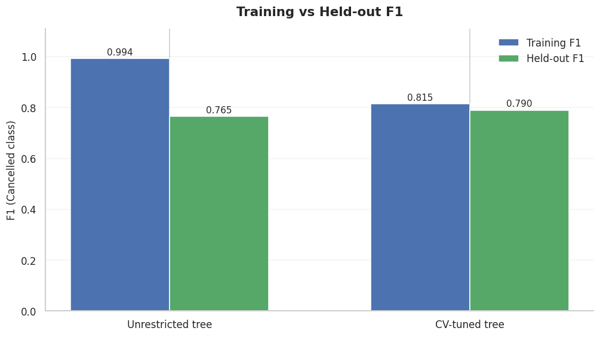
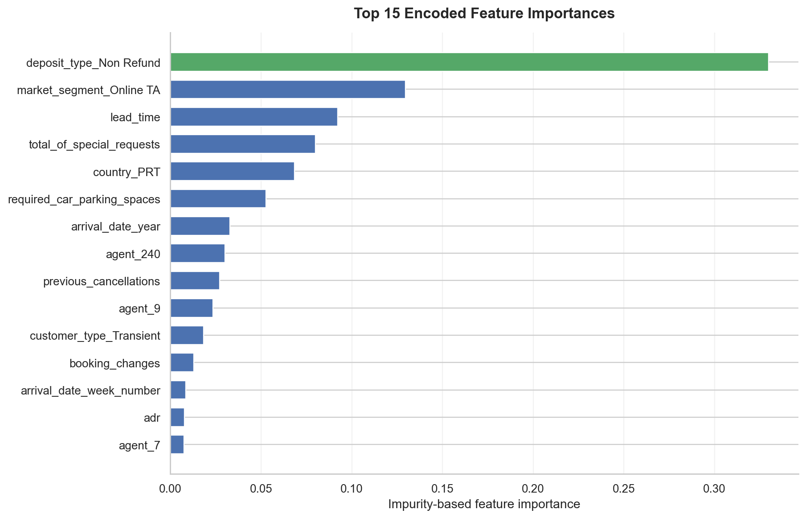

# Hotel Booking Cancellation Prediction | Decision Tree

Can booking details help identify reservations at risk of cancellation? In this project I explore that question with an interpretable Decision Tree, paying as much attention to **evaluation design and model errors** as to the final F1 score.

I examine the data, remove outcome leakage, build a preprocessing pipeline, and compare an unrestricted tree with a tuned one. Because the dataset contains many repeated rows, I keep identical **predictor patterns** together in both the held-out split and cross-validation.

> **Scope:** This is a pre-arrival research experiment, not a deployed booking-creation model. Some retained booking fields may change over time, and the results have not been tested on a future period or a separate hotel.

## Project links

- **GitHub project:** [hotel-booking-cancellation-decision-tree](https://github.com/anahitapouladi/hotel-booking-cancellation-decision-tree)
- **Kaggle project:** [hotel-booking-cancellation-decision-tree](https://www.kaggle.com/code/anahitapouladi/hotel-booking-cancellation-decision-tree)

## At a glance

| | Result |
|---|---|
| Dataset | 119,390 bookings × 32 original columns |
| Target | `is_canceled` (`0` = Not Cancelled, `1` = Cancelled) |
| Exact duplicate raw rows | 31,994 |
| Repeated retained-predictor rows | 33,534 |
| Train / held-out test | 95,515 / 23,875 rows |
| Cancellation rate (train / test) | 37.0% / 37.0% |
| Shared predictor groups across train/test | **0** |
| Model search | 32 configurations × 5 grouped folds = 160 fits |
| Best grouped-CV F1 (fold SD) | 0.7959 (0.0056) |

The repeated-pattern count is larger than the exact-duplicate count because rows that differ only in the removed columns, or in the label, share the same predictors.

## Results on the held-out groups

| Metric | Unrestricted tree | CV-tuned tree |
|---|---:|---:|
| Accuracy | 0.8294 | 0.8469 |
| Precision — Cancelled | 0.7786 | 0.8159 |
| Recall — Cancelled | 0.7537 | 0.7576 |
| F1 — Cancelled | 0.7659 | **0.7856** |
| Training F1 | 0.9939 | 0.8202 |
| Train–test F1 gap | 0.2280 | 0.0345 |
| Tree depth | 55 | 12 |
| Leaves | 9,861 | 508 |
| False positives (false alerts) | 1,896 | 1,512 |
| False negatives (missed cancellations) | 2,178 | 2,144 |

The tuned tree's held-out F1 improved by **+0.0197**. Precision rose from 0.7786 to 0.8159, while recall changed only slightly. In this run, the model caught **34 more actual cancellations** and raised **384 fewer false alerts**. The selected configuration uses `class_weight=None`, so the change should not be attributed to class reweighting.

A paired bootstrap resampling complete held-out predictor groups produced a **95% interval of [+0.0106, +0.0292]** for the F1 difference (2,000 resamples). This describes uncertainty conditional on the held-out sample and fitted models, not future-period performance.

The majority-class reference model achieved **0.6296 accuracy** but **0.0000 F1** for cancellations, showing why accuracy alone is insufficient.

### Selected tree settings

| Hyperparameter | Selected value |
|---|---|
| Criterion | `gini` |
| Max depth | `12` |
| Minimum samples per split | `10` |
| Minimum samples per leaf | `5` |
| Class weight | `None` |
| Cost-complexity alpha | `0.0` (fixed, not tuned) |

This is a deliberately small grid: each varied parameter has only two candidate values. The top five mean CV F1 scores span about **0.0016**, so their ranking should not be overinterpreted relative to fold-to-fold variation.

## Visual analysis

| Class distribution | Missing values |
|---|---|
|  |  |

44,224 of 119,390 bookings (37.0%) were cancelled. `company` is missing in 94.3% of rows and `agent` in 13.7%, which is why `company` is dropped and missing agents become an "Unknown" category.

**Unrestricted tree — held-out confusion matrix**



**CV-tuned tree — same row-normalized scale**


The unrestricted tree misses 2,178 cancellations and raises 1,896 false alerts. The tuned tree misses 2,144 and raises 1,512.

| Training vs held-out F1 | Error trade-off |
|---|---|
|  |  |

The unrestricted tree scores 0.994 F1 on training data but 0.766 on held-out data. After tuning, the scores are 0.820 and 0.786. The smaller tree produces 384 fewer false alerts and 34 fewer missed cancellations on this split.

| Top feature importances | First levels of the tuned tree |
|---|---|
|  |  |

`deposit_type_Non Refund` is both the first split and the most important feature (0.379). In the training data 99.3% of non-refundable bookings were cancelled, a pattern that may reflect booking rules or recording practices rather than guest behavior. In this fitted tree, `value` shows raw class counts because `class_weight=None`.

**Training-only Pearson correlation heatmap**


`lead_time` has the strongest linear link with cancellation (+0.29). Special requests (−0.23), parking spaces (−0.20) and booking changes (−0.14) point the other way. Correlation only captures straight-line association, so the tree can still use features that look weak here.

The palette uses blue `#4C72B0`, green `#55A868`, and neutral gray `#7F7F7F`. Confusion matrices use a fixed 0–100% row scale and display raw counts alongside percentages.

## What I learned

- Tuning gave a modest F1 gain on this held-out split (+0.0197). The bigger change was in structure: 9,861 leaves became 508, and the train–test gap fell from 0.2280 to 0.0345.
- Repeated rows changed how I evaluated the model. I kept identical predictor patterns together instead of assuming they were mistakes.
- A feature-importance plot shows what the model uses, not why guests cancel.

## Method

1. **Check the data.** Inspect missing values, cancellation balance, data types, and repeated rows.
2. **Review feature availability.** Remove `reservation_status` and `reservation_status_date` (final-outcome leakage), `assigned_room_type` (timing uncertainty), and `company` (high missingness and identifier semantics).
3. **Engineer two features.** `total_nights` summarizes stay length; `total_guests` summarizes party size. Treat `agent` as a category, not a numeric amount.
4. **Hold out repeated patterns.** Hash retained predictor columns, excluding the target, and hold out one `StratifiedGroupKFold` fold. Verify there are no shared groups.
5. **Fit preprocessing inside the pipeline.** Median imputation for numeric features; most-frequent imputation and one-hot encoding for categorical features.
6. **Tune on training folds only.** Five-fold `StratifiedGroupKFold` in `GridSearchCV`, selecting by cancellation F1. The test set stays out of hyperparameter selection.
7. **Interpret the final test.** Compare F1, precision, recall, error types, tree size, and impurity-based feature importance. Estimate within-split uncertainty using a paired group bootstrap.

## Repository layout

```text
hotel-booking-cancellation-decision-tree/
├── README.md
├── requirements.txt
├── LICENSE
├── .gitignore
├── notebooks/
│   └── Hotel_Booking_Cancellation_Prediction_Decision_Tree.ipynb
├── images/                   # nine saved figures
├── docs/
│   ├── Validation_Report.md
│   └── run_metrics.json
└── data/
    └── README.md             # instructions; CSV not committed
```

## Run locally or on Kaggle

**Data:** Download the original [Hotel Booking Demand dataset](https://www.kaggle.com/datasets/jessemostipak/hotel-booking-demand) and place `hotel_bookings.csv` in `data/` (see [`data/README.md`](data/README.md)). The raw CSV is intentionally excluded from this repository.

```bash
python -m pip install -r requirements.txt
jupyter notebook
```

Open [the notebook](notebooks/Hotel_Booking_Cancellation_Prediction_Decision_Tree.ipynb) and select **Restart & Run All**. The 160-fit grid search can take several minutes. Running from the repository root or the `notebooks/` folder is supported.

**On Kaggle:** Upload the `.ipynb` file, attach the Hotel Booking Demand dataset using **Add Input**, and run the notebook. The data loader checks `/kaggle/input` automatically. The nine plots are saved as PNGs to `images/` under the working directory.

**Outputs:** The notebook saves nine figures to `images/`. [`docs/run_metrics.json`](docs/run_metrics.json) is a **static snapshot of the saved run**; rerunning the notebook does not update it. Refresh the README, figures and snapshot together if you publish new results. The [reproducibility notes](docs/Validation_Report.md) describe the checks.

**Reproducibility:** The saved notebook describes a Python 3.13 / scikit-learn 1.9.1 run. The 20 code cells were also independently re-executed using Python 3.13.5 and scikit-learn 1.8.0; the model metrics, split, selected settings and bootstrap interval matched the saved outputs. `requirements.txt` pins the environment used for that independent verification, not the original 1.9.1 environment. The dataset has many repeated predictor patterns, so different library versions or platforms can change the group split and selected settings. **Precision, recall, and the error trade-off can shift noticeably**, not just the last decimals. If you rerun the notebook, check that its narrative, figures, README and metrics snapshot still match the new outputs.

## Limitations

- Exact predictor matches do not prove that rows represent the same guest or reservation. Grouping controls one kind of overlap, not all dependencies.
- Some identical predictor patterns have different outcomes (282 patterns across 2,084 rows), so the retained fields do not perfectly determine the cancellation label.
- The data covers 2015–2017; no chronological hold-out or separate-hotel evaluation was performed. `arrival_date_year` and calendar or price fields may capture period-specific patterns.
- The intended pre-arrival prediction time needs a source-system audit. Some retained features, including booking changes, price, special requests, and parking spaces, can evolve during the reservation lifecycle.
- High-cardinality agent and country categories can learn dataset-specific patterns.
- The importance of `deposit_type_Non Refund` may reflect reservation policies or recording practices. Impurity-based importance does not establish cause and effect.
- Missing `country` values (488 rows) are imputed with the most common country (`PRT`), which is also an important feature. A separate "Unknown" category would be more transparent.
- The selected settings, and which error type improves most, can change with the split and library version, so the +0.0197 F1 gain should not be read as a precise or fixed number.
- F1 is an educational selection metric; an operational system would need a cost-sensitive threshold and monitoring.

## Attribution and license

The [Hotel Booking Demand dataset](https://www.kaggle.com/datasets/jessemostipak/hotel-booking-demand) is distributed by Jesse Mostipak under **CC BY 4.0** and draws on *Hotel Booking Demand Datasets* by Nuno António, Ana de Almeida, and Luís Nunes ([Data in Brief, 2019](https://doi.org/10.1016/j.dib.2018.11.126)). This repository does not redistribute the dataset. The [MIT license](LICENSE) covers the original project code and documentation.

## Author

Anahita Pouladi · [GitHub](https://github.com/anahitapouladi) · [Kaggle](https://www.kaggle.com/anahitapouladi)
